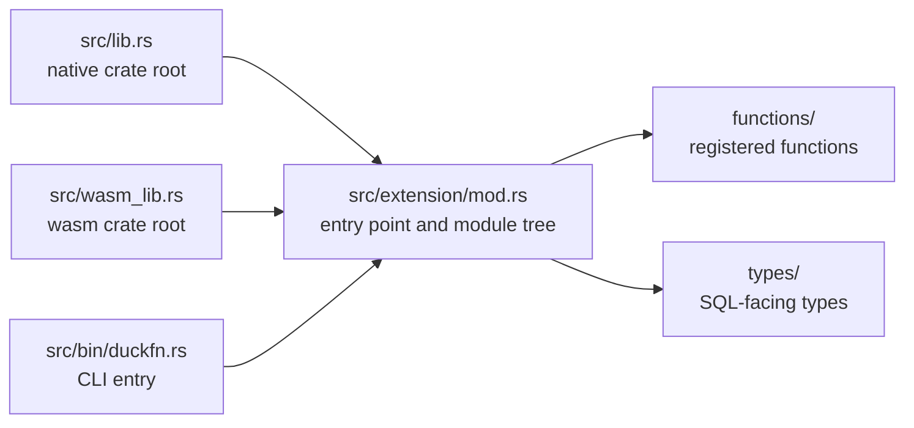

# Project structure

```text
src/lib.rs             native crate root  ->  mod extension;
src/wasm_lib.rs        wasm crate root    ->  mod extension;   (the same mods, mirrored)
src/extension/mod.rs   ->  duckfn_entrypoint!("duckfn_palette"); + mod functions; mod types;
src/bin/duckfn.rs      duckfn CLI entry   ->  #[path] mod extension; + duckfn::cli::run(...)

src/extension/functions/          one file per palette module (the tree mirrors the upstream crate)
    convert.rs           constructors for all 44 spaces, plt_convert / clamp / alpha accessors
    manipulate.rs        Mix / Lighten / Darken / Saturate / hue / premultiply
    blend.rs             Blend, Compose, BlendWith (custom equations)
    difference.rs        color_difference metrics, WCAG relative luminance and contrast
    theory.rs            the ColorScheme harmonies
    named.rs             palette's named colors
    css.rs               csscolorparser: parse / serialize, plus hex in and out
    cast.rs              cast::Packed: 8-bit pack / unpack
    encoding.rs          transfer functions, primaries, RGB<->XYZ matrices
    adaptation.rs        white points, LMS matrices, chromatic adaptation
    matrix.rs            matrix / convert::Matrix3 arithmetic
    cam16.rs             CAM16 with explicit viewing conditions
    colorous.rs          colorous gradients and categorical palettes
    random.rs            random_sampling
src/extension/types/              same file names: the SQL-facing shape of each module
    color.rs             PltColor, the plt_color STRUCT, and the space table
    ops.rs / blend.rs / difference.rs / theory.rs / adaptation.rs / encoding.rs /
    matrix.rs / cam16.rs / cast.rs / colorous.rs / random.rs

test/sql/                   one .test per module, plus a duckfn_palette.test smoke test
scripts/rename.sh           rename the extension after cloning
scripts/release.sh          version bump, tag, development version
Justfile                    the everyday commands
docs/                       this documentation site
community-extension/        the community-extension registration draft
```

## The two crate roots

`src/lib.rs` and `src/wasm_lib.rs` both declare exactly one module, `mod extension;`, and
`extension/mod.rs` attaches everything else. The official Rust template instead writes `mod lib;` and
forwards it a second time from the wasm root, which breaks as soon as modules nest
(`error[E0583]: file not found for module …`): there would be two copies of the same path set to keep
in sync.

Three entry points compile the same module tree — the two crate roots and the CLI:



Adding a module therefore means editing `extension/mod.rs` (and the `mod.rs` of the layer below), never
the crate roots.

## The command-line bin

`src/bin/duckfn.rs` compiles the extension a second time with `#[path = "../extension/mod.rs"] mod
extension;` and calls `duckfn::cli::run(...)`. It exists to export the function-description CSV
(`just docs_csv`) and takes no part in the extension itself.

The `#[path]` attribute is not a shortcut, it is necessary: the documentation metadata behind
`#[duck_*]` is collected by `inventory`'s static constructors, which only fire for object files that
are really linked into the final binary. With `use duckfn_palette::…` the linker may drop those modules
and the exported CSV comes out empty — silently.

## One file per upstream module, the prefix as a namespace

Files under `functions/` are named after the palette module they wrap (`blend.rs` for `palette::Blend`,
`encoding.rs` for `palette::encoding`, …), and `types/` keeps the same names for the SQL-facing shape of
that module. Following the upstream tree is what makes a missing function visible: a palette trait with
no file next to it is a gap, not an oversight buried in a 2000-line file.

Every registered name carries the same short prefix (`plt_`); the reasoning is in `AGENTS.md`: community
extensions almost never put the package name into function names, and a short prefix is enough to search
`duckdb_functions()` by. Constructors are named after the space itself, so `plt_oklch` both constructs an
Oklch color and matches the `oklch` space tag.

## `types/` holds the shared shape

`types/color.rs` defines `PltColor`, the `plt_color` STRUCT every function takes and returns
(`space`, `c1`, `c2`, `c3`, `alpha`), plus the space table that maps a SQL space name onto the palette
type. The other files hold what palette exposes beyond a color: `cam16.rs` the `Parameters` struct and
its surrounds, `matrix.rs` the row-major nine-double encoding, `adaptation.rs` the white-point and
method names, and each module's list of accepted option strings.

Three kinds of thing belong there:

- named types defined with `#[derive(DuckStruct)]` and registered into DuckDB at load time;
- the row type of a `list<struct<...>>` result (a plain Rust struct deriving `DuckStruct`);
- the constants and parsers that give a function its error messages, shared by every signature in the
  module.

## Dependencies

`Cargo.toml` carries a comment per crate saying what it is for and why it was picked. The choices that
shape the build:

- **[duckfn](https://crates.io/crates/duckfn)** — the attribute macros that register ordinary Rust
  functions with DuckDB. Only the `cli` feature is on (it is what `src/bin/duckfn.rs` drives); `all` is
  avoided on purpose, because it also turns on `duckdb-1-5`, the **unstable region** of DuckDB's C API
  (copy functions, the host VFS, the scalar bind/init slots). Staying in the stable region is what makes
  one binary portable across DuckDB releases. The `chrono` / `uuid` / `rust_decimal` conversions are
  ABI-neutral and can be turned on when needed; `owned-connection` (which gates the host file system
  `duckfn::duck_vfs`) sits in the unstable region and is not needed.
- **[quack-rs](https://crates.io/crates/quack-rs)** — the DuckDB C API bindings the code expanded by
  `duckfn_entrypoint!` refers to directly.
- **[libduckdb-sys](https://crates.io/crates/libduckdb-sys)** — headers only (`loadable-extension`),
  which is what keeps a local DuckDB build unnecessary.

The domain crates are the reason this extension exists:

- **[palette](https://crates.io/crates/palette)** — color types, conversion, blending, color
  difference, chromatic adaptation, named colors and random sampling. The `random` feature is on for the
  per-space `Standard` distributions; `named`, `std` and `approx` come by default.
- **[csscolorparser](https://crates.io/crates/csscolorparser)** — CSS Color Level 4 strings in both
  directions; palette covers the arithmetic, not the formats.
- **[colorous](https://crates.io/crates/colorous)** — the d3-scale-chromatic gradients and categorical
  palettes.
- **[rand](https://crates.io/crates/rand)** — the seeded PRNG behind `plt_random_color`. It is pinned to
  the same major version palette's `random` feature uses (0.8), so only one `rand` enters the graph.

For anything date/time related, enable duckfn's `chrono` feature and add `chrono` as a dependency (duckfn
re-exports none of those crates); the two ready-made lines are at the bottom of `Cargo.toml`.

## What this extension does not use

The extension is all scalar functions and custom STRUCT types. None of the following is in it. Write them
from duckfn's docs and example extension rather than from memory:

- table functions / `COPY` / casts / replacement scans / SQL macros (one attribute macro each; see
  duckfn's `docs/docs/guide/` and its example extension under `src/extension/`);
- `DuckLazy<T>` arguments ("parse the options once") — every option here is a plain `VARCHAR` name;
- DuckDB's host file system (`duckfn::duck_vfs`; enable `owned-connection` explicitly) and the
  chrono / uuid / rust_decimal bridges;
- platform-specific dependencies (the `[target.'cfg(...)'.dependencies]` pattern).

What it does use beyond the simplest shape: `overloads_name` (several signatures merged under one name —
`plt_pack`, `plt_difference`, `plt_chromatic_adapt`, `plt_cam16_params`), `#[derive(DuckStruct)]` for the
`plt_color`, `plt_cam16_params` and `plt_cam16_full` STRUCTs, and `Vec<T>` results for the list-returning
functions.

## Naming rules

| Rule | Why |
| --- | --- |
| The extension name is lowercase with underscores, and identical in five places. | It is the entry-point symbol and the artifact file name; DuckDB looks the symbol up by the file name. `just rename` writes all five. |
| Every registered SQL name carries one short prefix (`plt_` here). | DuckDB has no namespaces, and community extensions almost never put the package name into function names. See the conventions in `AGENTS.md`. |
| `src/lib.rs` and `src/wasm_lib.rs` always declare the same set of `mod`s. | Otherwise the wasm build fails to compile the module tree. |
| Temporary files (scripts, data, logs) go to `target/`. | `target/` is git-ignored and never pollutes the tracked tree. |
| Text files use LF. | The repository stores LF; the `.gitattributes` normalization relies on it. |

## Where the development notes are

The design notes live in this guide: the module layout above, [writing
functions](./writing-functions.md), [testing](./testing.md) and [build and
release](./build-and-release.md). `AGENTS.md` holds the repository's conventions, the release flow and a
topic-by-topic map of duckfn's own documentation — everything the attribute macros can do lives there,
not in this repository.

Since duckfn 0.0.11 that documentation, plus a runnable example extension and its SQLLogicTest files,
ship **inside the crate package**, so they always match the version in `Cargo.toml` and need no clone of
the duckfn repository:

```shell
# after any build: the sources cargo actually compiled against
ls -d ~/.cargo/registry/src/*/duckfn-*/
```

| Path under that directory | What it is |
| --- | --- |
| `docs/docs/**` | The user guide's text (English), including the chapter per registration kind. |
| `docs/i18n/zh-Hans/…/current/**` | The same guide in Simplified Chinese. |
| `src/extension/**` | The example extension: one file per registration kind, plus custom types and a combined demo. |
| `test/sql/**` | SQLLogicTest files for the example, worth copying the structure of. |

The rendered guide is also online — [shijianjs.github.io/duckfn](https://shijianjs.github.io/duckfn/) —
but it may be newer than your dependency; the copy in the registry is what this project is compiled
against.
