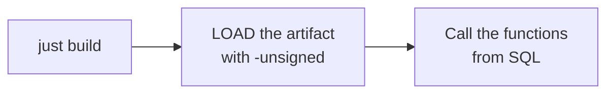

# Quick start

The whole page in three steps:



## Prerequisites

- **Rust** 1.86 or newer (`rust-version` in `Cargo.toml`).
- **[just](https://github.com/casey/just)** — the tool the recipes call:

  ```shell
  cargo install just
  ```

- **make** (inside Git Bash on Windows) and **Python 3** — the official DuckDB
  `extension-ci-tools` build/test flow, which `just build` runs under the hood (`make configure` +
  `make debug`). `just test` uses the same flow.
- A **DuckDB** binary 1.4 or newer (`duckdb` on `PATH`, or point at it with
  `just DUCKDB=/path/to/duckdb …`).

## 1. The extension name

This repository is `duckfn_palette` and the name is already consistent in the five places that have to
agree — `Cargo.toml` (`[package] name` and `[[example]] name`), `EXTENSION_NAME` in the Makefile, the
entry-point symbol in `src/extension/mod.rs`, the Justfile and the CI workflow. Keep it that way: editing
one of them alone makes `LOAD` fail on the symbol lookup.

A project freshly created from [duckfn-extension-template](https://github.com/shijianjs/duckfn-extension-template)
runs `just rename <new_name>` (`scripts/rename.sh`), which rewrites all five plus every occurrence in the
docs, and regenerates the `Cargo.lock` entry. What still needs a human pass afterwards:

1. **`AGENTS.md`** — fill in the `{{PROJECT_GOAL}}` placeholder and the function-name prefix.
2. **`LICENSE`** — the copyright holder.
3. **`community-extension/description.yml`** — `extension.name` / `description` / `maintainers` / `repo`;
   the field-by-field reasoning is in [community extensions](./community-extension.md).
4. **Before the first release**, make sure the repository has a `main` branch and an `origin` remote:
   `just release_tag` pushes both.

## 2. Build

```shell
just build          # = make configure && make debug
```

The artifact is `build/debug/duckfn_palette.duckdb_extension`. There is no C++ step and no local DuckDB
build: the extension is compiled against DuckDB's headers and dispatches through its API table when it
is loaded.

## 3. Load and call it

```shell
just repl           # a DuckDB REPL with the extension already loaded
```

```sql
-- or by hand; -unsigned is required for a locally built extension
duckdb -unsigned -c "LOAD './build/debug/duckfn_palette.duckdb_extension';"
```

Some of the functions, running right here — the site preloads the extension from the repository's latest
release, so no local `LOAD` is needed here (a hand-built extension still needs `-unsigned`; see the
traps below). Click **Run** on any block.

```sql {"type":"duckfn","show":"table"}
SELECT plt_to_hex(plt_convert(plt_srgb(1, 0.5, 0), 'oklch')) AS as_oklch,
       plt_to_hex(plt_mix(plt_named('red'), plt_named('blue'), 0.5)) AS mixed;
```

```sql {"type":"duckfn","show":"table"}
-- A NULL argument is short-circuited to NULL before the function body ever runs.
SELECT plt_to_hex(plt_convert(plt_srgb(1, 0, 0), 'lab')) AS converted,
       plt_convert(NULL, 'lab') IS NULL AS null_in_null_out;
```

The failure path is a runnable block too — it declares that it is supposed to fail:

```sql {"type":"duckfn","expect":"error"}
SELECT plt_convert(plt_srgb(1, 0, 0), 'nope');    -- error: unknown color space
```

A single query from the command line, without a REPL:

```shell
just sql "SELECT plt_to_hex(plt_named('rebeccapurple'))"
```

## 4. Run the tests

```shell
just test           # make configure + make debug + make test
```

The faster loop is in [Testing](./testing.md).

## Traps

:::warning[Three things that look like bugs and are not]

- **`-unsigned` is mandatory** when you load a locally built extension. Without it DuckDB refuses
  the file.
- **The artifact file name must stay `<extension name>.duckdb_extension`.** DuckDB finds the
  entry-point symbol through the file name, so a copy called `win.duckdb_extension` fails with
  `did not contain function "duckfn_palette_init_c_api"`.
- **`make test` does not rebuild.** After changing Rust code run `just ci-build` (or `make debug`)
  first, otherwise the tests run against the previous artifact.

:::

One more, on Windows: if `make debug` reports the artifact is in use, a DuckDB process is
holding `build/debug/duckfn_palette.duckdb_extension` (usually a `just repl` left open) — close that
process and rebuild. A `.duckdb_extension` is not a renamed DLL: DuckDB's metadata lives at the end of
the file, so copying a DLL over it produces `The metadata at the end of the file is invalid`.
