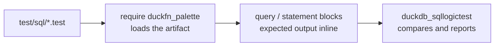

# Testing

Tests are [SQLLogicTest](https://duckdb.org/dev/sqllogictest/intro) files under `test/sql/`, the same
format DuckDB uses for its own test suite. A file is a sequence of `query` and `statement` blocks with
the expected result inline, so a test doubles as a worked example of the function's behaviour.

| File | What it covers |
| --- | --- |
| `duckfn_palette.test` | Smoke test: no `plt_` function exists before `LOAD`, all of them do after `require`. The smallest proof that the extension loads at all. |
| `convert.test` | Constructors for every space, `plt_convert` round trips across the whole space table, `plt_clamp` / `plt_is_within_bounds`, the alpha accessors, `plt_from_components` arity errors. |
| `manipulate.test` | `plt_mix` endpoints and midpoints, the `_fixed` and proportional variants of lighten / darken / saturate / desaturate, hue shift and set, premultiply / unpremultiply, and the "space does not support this operation" error path. |
| `blend.test` | All 11 blend modes, all 6 composition operators, custom equations with every factor, source/destination order, alpha handling. |
| `difference.test` | The 7 metrics against palette's own asserted values, WCAG relative luminance and contrast (black/white = 21), every criterion in `plt_contrast_check`. |
| `theory.test` | The scheme functions on a hue space, `plt_harmony` by name, list lengths, the "no hue" error. |
| `named.test` | Named colors across the whole table, case and separator normalization, unknown-name errors. |
| `css.test` | csscolorparser: hex / `rgb()` / `hsl()` / `lab()` / `oklch()` / `color()` parsing, serialization formats, invalid input → `plt_css_is_valid` false and `NULL` results. |
| `cast.test` | Pack / unpack in the four channel orders, 8-bit quantization round trips, hex output for packed values, order-name errors. |
| `encoding.test` | Transfer functions decode/encode against palette's asserted values, 101-point round trips, primaries summing to the white point, RGB↔XYZ matrices and their inverses. |
| `adaptation.test` | All 16 white points, the three adaptation methods against palette's upstream matrices (1e-4 tolerance), the full matrix decomposing into LMS · gain · LMS⁻¹, alpha preservation. |
| `matrix.test` | palette's own `multiply_3x3` / `apply` assertions, inverse checks, `inverse(adaptation)` ≈ the reverse adaptation, singular-matrix errors, `matrix_arg` length errors. |
| `cam16.test` | palette's seven asserted CAM16 colors, full-attribute and partial-space round trips, custom viewing conditions changing the result, agreement with `plt_convert` under the default conditions. |
| `colorous.test` | Every gradient and categorical palette name, endpoints and clamping of `t`, evenly sampled lists, whole categorical palettes, unknown-name and `n < 1` errors. |
| `random.test` | Every random space tag matches its request, same seed same color, different seeds differ, sequence prefixes, component ranges over 200 seeds, spaces without a distribution. |

## Running them

How a file reaches the runner:



```shell
just test                 # = make configure + make debug + make test
just ci-build             # just the official build, without the tests
```

`just test` goes through DuckDB's official Makefile flow, which is also what CI runs. Two things to
know about it:

- **It does not rebuild.** After touching Rust code run `just ci-build` (or `make debug`) first, or the
  tests run against the previous artifact.
- **On Windows `make` has to run inside Git Bash**, not PowerShell.

### The fast loop

DuckDB's test runner can drive the artifact directly, which skips `make` entirely. The recipe needs a
Python environment with `duckdb_sqllogictest` installed — `make configure` creates one under
`configure/venv`, or you can use any Python 3 environment that has it:

```bash
# Linux / macOS
./configure/venv/bin/python -m duckdb_sqllogictest \
    --test-dir test/sql \
    --external-extension build/debug/duckfn_palette.duckdb_extension
```

```powershell
# Windows
.\configure\venv\Scripts\python.exe -m duckdb_sqllogictest `
    --test-dir test/sql `
    --external-extension build/debug/duckfn_palette.duckdb_extension
```

`--test-dir` is required: it is also the value of `__TEST_DIR__`, the directory a test writing files is
given. To run a single file, add `--file-path test/sql/convert.test`.

## Conventions

- **Every file starts from a clean database**, so `duckfn_palette.test` can assert that the functions do
  not exist before the extension is loaded, and the other files start with `require duckfn_palette`.
- **Expected errors are matched as substrings.** Under `statement error`, a distinctive fragment of the
  message is enough — there is no need to reproduce DuckDB's whole error string, and doing so ties the
  test to a message that may well change.
- **Expected numbers come from upstream, never from a re-derivation.** palette's own `assert` and
  doctest values are the ground truth; where palette compares with a tolerance, the test does too — as a
  count of violations, not as a rendered float:

  ```sql
  query I
  SELECT count(*) FROM (SELECT unnest(plt_adaptation_matrix('d65','d50','bradford')) AS a,
                              unnest([1.0478112, 0.0228866, …]) AS e)
  WHERE abs(a - e) >= 0.0001;
  ----
  0
  ```

- **Watch how values print.** A `DOUBLE` renders as `7.0`, and a `BOOLEAN` in an `I` column comes out as
  `1` / `0`. When a test is about a value rather than a type, cast it (`…::VARCHAR`) or assert through
  `count(*)`, so the expectation stays stable if the type changes.
- **Divide the files by concern**, one per palette module, mirroring `src/extension/functions/`.

## What a new function should cover

At least: ordinary values, `NULL`, a boundary value, and the error path. For this extension that means a
space name, a mode name or a metric name that does not exist — the error text starts with the function
name. Three more that pay off:

- the round trip (`plt_convert` out and back, `plt_pack` then `plt_unpack`), which catches a swapped
  component order that no single value would show;
- the alpha channel surviving every operation, asserted once per family rather than per function;
- more rows than `STANDARD_VECTOR_SIZE` (2048), which exercises the per-chunk path for a scalar —
  `generate_series` is the shortest way to get there.

Before committing: `just lint` (`cargo clippy --all-targets -- -D warnings`).
