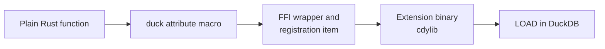

# Writing functions

A registered function is "an ordinary Rust function plus one attribute macro". The macro writes the FFI
wrapper, reads the argument columns, writes the result column, and submits the registration; the body
holds nothing but your logic.

The path from a plain function to a callable SQL function:



## The shapes in use here

| Shape | Example | Meaning |
| --- | --- | --- |
| `-> T` | `plt_srgb(c1, c2, c3) -> PltColor` | A plain value, never NULL. |
| `-> DuckOptionResult<T>` | `plt_convert(color, space)` | Nullable and fallible: `Ok(None)` is SQL `NULL`, `Err` fails the query. |
| `-> Vec<T>` | `plt_colorous_palette(name, n)` | A SQL `LIST`, one row per input row. |
| `-> DuckOptionResult<Vec<T>>` | `plt_rgb_primaries(space)` | A list that can also be NULL or fail. |
| `overloads_name` | `plt_pack`, `plt_difference` | Several Rust functions registered under one SQL name. |

Everything is a scalar function — there is no aggregate, table function or `COPY` handler in this
extension. `src/extension/functions/` mirrors palette's modules, so a new function goes into the file that
covers its upstream trait.

## Scalars: three return shapes

The macro generates different code per return type:

| Signature | Meaning |
| --- | --- |
| `-> T` | A plain value, never NULL. |
| `-> DuckOptionResult<T>` | Nullable and fallible: `Ok(None)` becomes SQL `NULL`, `Err` fails the whole query. |
| `-> Option<T>` | Nullable but unable to fail. |

```rust
use duckfn::{DuckOptionResult, duck_scalar_function};

#[duck_scalar_function(
    description = "Convert a color to another space without gamut clamping (palette's unclamped conversion)",
    example = "SELECT plt_components(plt_convert(plt_srgb(1, 0, 0), 'lab'))"
)]
fn plt_convert(color: PltColor, space: String) -> DuckOptionResult<PltColor> {
    Ok(Some(color.convert("plt_convert", &space)?))
}
```

The three-state contract is the same in every file: a NULL argument gives NULL (duckfn short-circuits it
before the body runs), something palette cannot compute gives `Ok(None)`, and a rejected argument gives
`Err` with a message that starts with the function name.

### What happens to a NULL argument

Argument nullability is decided by the parameter type:

- **`space: String`** — a NULL input row is short-circuited to SQL `NULL` by duckfn's argument reader;
  the body never runs for that row. This is what you want most of the time.
- **`space: Option<String>`** — NULL reaches the body as `None` and its meaning is yours to decide
  (return NULL, substitute a default, …).

### Errors and panics

Return `Err(duck_error("…"))` for a value the function cannot handle; that fails the query with your
message. A `panic!` in the body is caught and reported as a DuckDB error rather than unwinding across the
FFI boundary — which is what turns palette's own panics into query errors:

```rust
// palette panics on a singular matrix; the extension surfaces it as an error
plt_matrix_inverse([0.0, 0.0, 0.0, 0.0, 0.0, 0.0, 0.0, 0.0, 0.0]);
// -> The given matrix is not invertible
```

Error messages are user-facing: write them in English, and prefix them with the function name so a report
makes sense on its own.

## Custom types

`types/color.rs` defines `PltColor`, the `plt_color` STRUCT that every function takes and returns:

```rust
#[derive(DuckStruct)]
#[duck(sql_name = "plt_color", create_type = true)]
pub struct PltColor {
    pub space: String,
    pub c1: f64,
    pub c2: f64,
    pub c3: f64,
    pub alpha: f64,
}
```

One STRUCT for all 44 spaces keeps the surface small: the space name travels with the value, so
`plt_convert` needs no per-space function pair, and a color column round-trips through `SELECT *`. The
price is that components are positional (`c1`, `c2`, `c3`), which is what `plt_component(color, index)`
and `plt_components(color)` exist to smooth over.

`cam16.rs` adds two more: `plt_cam16_params` (the five viewing conditions plus discounting) and
`plt_cam16_full` (the six CAM16 attributes).

## Adding your own

1. **Pick the attribute.** This extension only needs `duck_scalar_function`; duckfn also has table
   functions, `COPY`, casts, SQL macros and replacement scans, each with its own macro and its own
   accepted arguments. The reference is [the duckfn user guide](https://shijianjs.github.io/duckfn/) —
   and the same guide ships inside the crate, in cargo's registry directory for the version in
   `Cargo.toml`.
2. **Copy the closest neighbor** from the file for that palette module rather than inventing a signature
   from scratch.
3. **Attach it to the module tree**: add `mod …;` to `src/extension/functions/mod.rs` (and to
   `src/extension/types/mod.rs` if it needs a type). The crate roots stay untouched — except that
   `src/wasm_lib.rs` mirrors them, so a new module must appear in both.
4. **Write the documentation metadata** on the attribute — `description`, `comment`, `example` /
   `examples`:

   ```rust
   #[duck_scalar_function(
       description = "One line for the function table of the community-extension page",
       comment = "The detail that does not fit the one-liner",
       example = "SELECT plt_to_hex(plt_convert(plt_srgb(1, 0.5, 0), 'oklch'))"
   )]
   ```

   DuckDB's C extension API has no way to set a description or an example, so this text is the only
   source for the `Added Functions` table on the community-extension page. `just docs_csv` exports it
   to `target/function_descriptions.csv` (see [Community extensions](./community-extension.md)).
   Write it in English — it is pasted onto that page as it is.
5. **Cover it with a test** (see [Testing](./testing.md)) and run `just lint`.

### Names

Every SQL name carries the `plt_` prefix, and the part after it reads like what the function does — the
space name for a constructor (`plt_oklch`), the palette trait for an operation (`plt_premultiply`), the
thing listed for the inventory functions (`plt_blend_modes`). A prefixed name is also what users type, so
resist `plt_palette_oklch`.

The attribute registers the **Rust function name** by default, which is why the functions are literally
called `plt_convert`. When one name needs several signatures (different argument types or counts),
`overloads_name = "…"` merges them into one function set instead of registering each separately — that is
how `plt_pack`, `plt_unpack`, `plt_difference`, `plt_chromatic_adapt` and `plt_cam16_params` each accept
two shapes.

The macro also generates a `SQL_NAME` constant per signature. Once a name appears in several places —
error prefixes, log lines, hints — read that constant rather than repeating the literal; the price is that
such a function has to be `pub(super)`, because the generated module inherits the function's visibility.

### Volatile functions

A function with a side effect (printing, writing a file, starting a process) or one that is
non-deterministic must be declared `volatile = true`. Otherwise the planner constant-folds it during
optimization, executes it once there and again inside the outer expression, and `EXPLAIN` runs it for
real. `plt_random_color` and `plt_random_colors` take a seed argument precisely so the result stays
reproducible — a random function without a seed would need `volatile = true`.

### Options arguments

A configuration argument (`DuckLazy<T>`) is parsed once and read inside the function, so per-row parsing
does not show up in profiles. This extension does not use one: every option here is a plain `VARCHAR`
name, resolved by a small table in the matching `types/` file. The pattern is documented in the duckfn
guide and used throughout [duckfn_quantstats](https://github.com/shijianjs/duckfn-quantstats).
