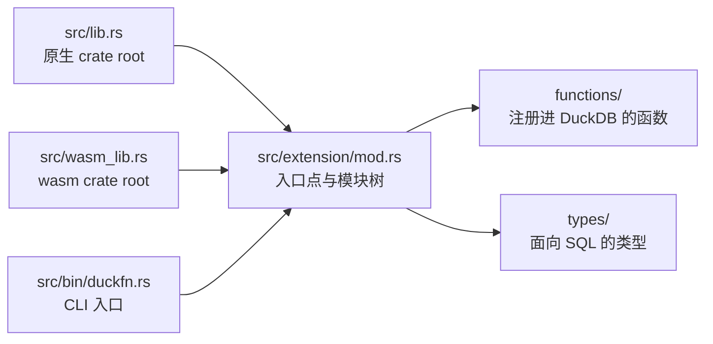

# 目录结构

```text
src/lib.rs             原生 crate root  ->  mod extension;
src/wasm_lib.rs        wasm crate root  ->  mod extension;   （同一组 mod，镜像）
src/extension/mod.rs   ->  duckfn_entrypoint!("duckfn_palette"); + mod functions; mod types;
src/bin/duckfn.rs      duckfn CLI 入口  ->  #[path] mod extension; + duckfn::cli::run(...)

src/extension/functions/          一个 palette 模块一个文件（目录树与上游 crate 同构）
    convert.rs           44 个空间的构造函数、plt_convert / clamp / alpha 读写
    manipulate.rs        Mix / Lighten / Darken / Saturate / 色相 / premultiply
    blend.rs             Blend、Compose、BlendWith（自定义方程）
    difference.rs        color_difference 各度量、WCAG 相对亮度与对比度
    theory.rs            ColorScheme 的各种和谐
    named.rs             palette 的命名色
    css.rs               csscolorparser：解析 / 序列化，外加 hex 进出
    cast.rs              cast::Packed：8 位打包 / 解包
    encoding.rs          传输函数、原色、RGB<->XYZ 矩阵
    adaptation.rs        白点、LMS 矩阵、色适应
    matrix.rs            matrix / convert::Matrix3 运算
    cam16.rs             显式观察条件下的 CAM16
    colorous.rs          colorous 的渐变与分类色板
    random.rs            random_sampling
src/extension/types/              同样的文件名：每个模块面向 SQL 的那层形状
    color.rs             PltColor、plt_color STRUCT 与空间表
    ops.rs / blend.rs / difference.rs / theory.rs / adaptation.rs / encoding.rs /
    matrix.rs / cam16.rs / cast.rs / colorous.rs / random.rs

test/sql/                   一个模块一份 .test，外加 duckfn_palette.test 冒烟测试
scripts/rename.sh           克隆后改扩展名
scripts/release.sh          提版本号、打 tag、切开发版本
Justfile                    日常命令
docs/                       这份文档站
community-extension/        社区扩展注册草稿
```

## 两个 crate root

`src/lib.rs` 与 `src/wasm_lib.rs` 都只声明一个模块 `mod extension;`，其余子模块由 `extension/mod.rs`
往下挂。官方 Rust 模板的写法是 `mod lib;` 再由 wasm 那个 root 转发一次，模块一嵌套就会
`error[E0583]: file not found for module …`：那等于同一组路径存了两份、要一直保持同步。

三个入口都编同一棵模块树 —— 两个 crate root 与那个 CLI：



所以新增模块只需要动 `extension/mod.rs`（以及下一层的 `mod.rs`），永远不用改 crate root。

## 命令行工具

`src/bin/duckfn.rs` 用 `#[path = "../extension/mod.rs"] mod extension;` 把扩展再编一遍，然后调用
`duckfn::cli::run(...)`。它存在的意义是导出函数描述 CSV（`just docs_csv`），不参与扩展本体。

那里的 `#[path]` 不是省事的写法，而是必需的：`#[duck_*]` 的文档元数据靠 `inventory` 的静态构造器收集，
只有**真正被链接进最终二进制**的目标文件才会生效。写成 `use duckfn_palette::…` 时，链接器可能把这些模块
整块丢掉，导出的 CSV 就会静默变空。

## 一个上游模块一个文件，前缀即命名空间

`functions/` 下的文件名就是它包住的那个 palette 模块（`palette::Blend` 对应 `blend.rs`、
`palette::encoding` 对应 `encoding.rs`……），`types/` 用同样的文件名放那个模块面向 SQL 的那层形状。
跟着上游的树走，缺函数才会看得见：一个 palette trait 旁边没有文件，那就是一张清单上的缺口，而不是埋在
两千行里的一处疏忽。

每个注册进 SQL 的名字都带同一个短前缀（`plt_`）；理由在 `AGENTS.md`：社区扩展几乎都不把包名写进函数名，
而短前缀足够在 `duckdb_functions()` 里检索。构造函数的名字就是空间本身，所以 `plt_oklch` 既是在构造一个
Oklch 颜色，也与 `oklch` 这个空间标签对得上。

## `types/` 放共用的形状

`types/color.rs` 定义 `PltColor` —— 每个函数收发的那个 `plt_color` STRUCT（`space`、`c1`、`c2`、`c3`、
`alpha`）—— 以及把 SQL 空间名映射到 palette 类型的空间表。其余文件放 palette 在「一个颜色」之外暴露的
东西：`cam16.rs` 是 `Parameters` 结构及其周边，`matrix.rs` 是行主序的九个 double 的编码，
`adaptation.rs` 是白点名与方法名，还有各模块那份「可接受的选项字符串」清单。

三类东西属于这里：

- 用 `#[derive(DuckStruct)]` 定义、并在加载时注册进 DuckDB 的具名类型；
- `list<struct<...>>` 返回值的行类型（一个 derive `DuckStruct` 的普通 Rust struct）；
- 给函数提供错误信息的常量与解析器，被该模块的每个签名共用。

## 依赖

`Cargo.toml` 里每个 crate 都写了一句它负责什么、为什么选它。决定构建形态的是这几个：

- **[duckfn](https://crates.io/crates/duckfn)** —— 把普通 Rust 函数注册进 DuckDB 的属性宏。只开了
  `cli` 这一个 feature（`src/bin/duckfn.rs` 要用）；刻意不开 `all`，因为它会一起打开 `duckdb-1-5`，
  也就是 DuckDB C API 的**不稳定区**（copy 函数、宿主 VFS、标量的 bind/init 槽位）。留在稳定区，
  才有一份二进制跨 DuckDB 版本通用。`chrono` / `uuid` / `rust_decimal` 这几个转换与 ABI 无关，需要时
  再开；`owned-connection`（它才打开宿主文件系统 `duckfn::duck_vfs`）属于不稳定区，用不到。
- **[quack-rs](https://crates.io/crates/quack-rs)** —— `duckfn_entrypoint!` 展开出的代码直接引用的
  DuckDB C API 绑定。
- **[libduckdb-sys](https://crates.io/crates/libduckdb-sys)** —— 只有头文件（`loadable-extension`），
  所以本地不需要编译 DuckDB。

领域那几个 crate 才是这个扩展存在的理由：

- **[palette](https://crates.io/crates/palette)** —— 颜色类型、转换、混合、色差、色适应、命名色与随机
  采样。开了 `random` feature，为的是各空间的 `Standard` 分布；`named`、`std`、`approx` 是默认 feature。
- **[csscolorparser](https://crates.io/crates/csscolorparser)** —— CSS Color Level 4 字符串的双向
  序列化；palette 管算术，不管格式。
- **[colorous](https://crates.io/crates/colorous)** —— d3-scale-chromatic 的渐变与分类色板。
- **[rand](https://crates.io/crates/rand)** —— `plt_random_color` 背后的带种子伪随机。它与 palette 的
  `random` feature 用的是同一个大版本（0.8），所以依赖图里只有一个 `rand`。

凡涉及日期时间的，开 duckfn 的 `chrono` feature 并把 `chrono` 加进来（duckfn 不 re-export 这些 crate）；
现成的两行就在 `Cargo.toml` 末尾。

## 本扩展没有用的东西

这个扩展全是标量函数与自定义 STRUCT 类型，下面这些都不在里面。要写就从 duckfn 的文档与示例扩展里抄，
不要凭记忆：

- 表函数 / `COPY` / cast / 替换扫描 / SQL 宏（各一个属性宏；见 duckfn 的 `docs/docs/guide/` 与它
  `src/extension/` 下的示例扩展）；
- `DuckLazy<T>` 参数（「配置只解析一次」）—— 这里的每个选项都是一个朴素的 `VARCHAR` 名字；
- DuckDB 的宿主文件系统（`duckfn::duck_vfs`，要显式打开 `owned-connection`），以及 chrono / uuid /
  rust_decimal 桥；
- 平台相关依赖（`[target.'cfg(...)'.dependencies]` 那套写法）。

比最简形态多用了的有：`overloads_name`（多个签名并成同一个名字下的一组 —— `plt_pack`、`plt_difference`、
`plt_chromatic_adapt`、`plt_cam16_params`）、给 `plt_color` / `plt_cam16_params` / `plt_cam16_full` 用的
`#[derive(DuckStruct)]`，以及返回列表的函数用到的 `Vec<T>`。

## 命名规则

| 规则 | 为什么 |
| --- | --- |
| 扩展名全小写、只含下划线，且五处一致。 | 它既是入口点符号，也是产物文件名；DuckDB 是按文件名去找符号的。`just rename` 负责写全这五处。 |
| 每个注册进 SQL 的名字共用一个短前缀（这里是 `plt_`）。 | DuckDB 没有命名空间，而社区扩展几乎都不把包名写进函数名。约定见 `AGENTS.md`。 |
| `src/lib.rs` 与 `src/wasm_lib.rs` 始终声明同一组 `mod`。 | 否则 wasm 构建编不出这棵模块树。 |
| 临时文件（脚本、数据、日志）放 `target/`。 | `target/` 已被 git 忽略，不会污染被跟踪的目录。 |
| 文本文件一律 LF。 | 仓库按 LF 入库，`.gitattributes` 的归一化依赖这一点。 |

## 开发笔记在哪

设计说明就在这份指南里：上面的模块结构、[写函数](./writing-functions.md)、[测试](./testing.md) 与
[构建与发布](./build-and-release.md)。`AGENTS.md` 里是仓库的约定、发版流程，以及一份「duckfn 自己的
文档按主题在哪儿」的对照表 —— 属性宏能做的所有事都在那边，不在本仓库里。

duckfn 0.0.11 起，那份指南连同**可运行的示例扩展**与它的 SQLLogicTest 用例都随 crate 一起发布，
所以它们始终与 `Cargo.toml` 里的版本一致，也不需要 clone duckfn 的 git 仓库：

```shell
# 跑过一次构建之后：cargo 实际编译的那份源码
ls -d ~/.cargo/registry/src/*/duckfn-*/
```

| 那个目录下的路径 | 是什么 |
| --- | --- |
| `docs/docs/**` | 用户指南正文（英文），含每类注册方式各一章。 |
| `docs/i18n/zh-Hans/…/current/**` | 同一份指南的简体中文版。 |
| `src/extension/**` | 示例扩展：每类注册方式一个文件，外加自定义类型与一个组合示例。 |
| `test/sql/**` | 示例的 SQLLogicTest 用例，抄结构用。 |

指南也有渲染好的在线版本 [shijianjs.github.io/duckfn/zh-Hans](https://shijianjs.github.io/duckfn/zh-Hans/)，
但它可能比你的依赖新；registry 里那份才是本项目实际编译的代码。
