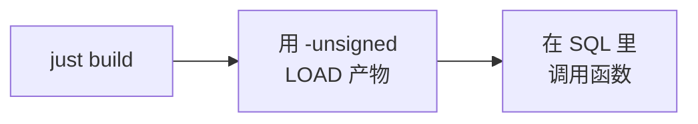

# 快速开始

整页就是三步：



## 前置条件

- **Rust** 1.86 或更新（`Cargo.toml` 里的 `rust-version`）。
- **[just](https://github.com/casey/just)** —— recipe 会调用它：

  ```shell
  cargo install just
  ```

- **make**（Windows 上要在 Git Bash 里跑）与 **Python 3** —— 官方 DuckDB
  `extension-ci-tools` 的构建 / 测试流程，`just build` 底层就是它（`make configure` + `make debug`），
  `just test` 走的也是同一套。
- 一个 **DuckDB** 1.4 或更新的可执行文件（`duckdb` 在 `PATH` 里，或者用
  `just DUCKDB=/path/to/duckdb …` 指定）。

## 1. 扩展名

本仓库就是 `duckfn_palette`，名字在必须保持一致的五处已经对齐 —— `Cargo.toml`（`[package] name` 与
`[[example]] name`）、Makefile 的 `EXTENSION_NAME`、`src/extension/mod.rs` 里的入口点符号、Justfile、
CI 工作流。请让它继续保持：只改其中一处，`LOAD` 就会在符号查找这一步失败。

从 [duckfn-extension-template](https://github.com/shijianjs/duckfn-extension-template) 新建的项目，
第一件事是 `just rename <新扩展名>`（`scripts/rename.sh`）—— 它一次改齐那五处以及文档里出现的每一处，
并按新包名重写 `Cargo.lock` 条目。之后还需要人工过一遍的：

1. **`AGENTS.md`** —— 填上 `{{PROJECT_GOAL}}` 占位符，以及函数名的前缀。
2. **`LICENSE`** —— 版权人。
3. **`community-extension/description.yml`** —— `extension.name` / `description` / `maintainers` / `repo`；
   逐个字段的依据在[社区扩展](./community-extension.md)。
4. **首次发版前**，确认仓库有 `main` 分支和 `origin` 远程：`just release_tag` 会同时推送这两者。

## 2. 构建

```shell
just build          # = make configure && make debug
```

产物是 `build/debug/duckfn_palette.duckdb_extension`。没有 C++ 这一步，也不需要本地编译 DuckDB：扩展
只用到 DuckDB 的头文件，加载时通过它的 API 表分发。

## 3. 加载并调用

```shell
just repl           # 已经 LOAD 好扩展的 DuckDB REPL
```

```sql
-- 或者手动来；本地构建的产物必须加 -unsigned
duckdb -unsigned -c "LOAD './build/debug/duckfn_palette.duckdb_extension';"
```

下面是几个函数，就地就能跑 —— 站点从仓库的最新 Release 预加载了这个扩展，这里不用写 `LOAD`
（本地自己构建的产物仍然要加 `-unsigned`，见下面的几个坑）。点任意块上的 **执行** 即可。

```sql {"type":"duckfn","show":"table"}
SELECT plt_to_hex(plt_convert(plt_srgb(1, 0.5, 0), 'oklch')) AS as_oklch,
       plt_to_hex(plt_mix(plt_named('red'), plt_named('blue'), 0.5)) AS mixed;
```

```sql {"type":"duckfn","show":"table"}
-- NULL 参数会在函数体执行之前被短路成 NULL。
SELECT plt_to_hex(plt_convert(plt_srgb(1, 0, 0), 'lab')) AS converted,
       plt_convert(NULL, 'lab') IS NULL AS null_in_null_out;
```

失败路径同样是个可运行块 —— 它自己声明了「应该失败」：

```sql {"type":"duckfn","expect":"error"}
SELECT plt_convert(plt_srgb(1, 0, 0), 'nope');    -- 报错：未知的颜色空间
```

不进 REPL、只跑一条语句：

```shell
just sql "SELECT plt_to_hex(plt_named('rebeccapurple'))"
```

## 4. 跑测试

```shell
just test           # make configure + make debug + make test
```

更快的迭代方式见[测试](./testing.md)。

## 几个坑

:::warning[三个看着像 bug、其实不是的]

- **本地构建的产物加载时必须加 `-unsigned`**，不加 DuckDB 会直接拒绝这个文件。
- **产物文件名必须保持 `<扩展名>.duckdb_extension`。** DuckDB 是按文件名去找入口点符号的，复制成
  `win.duckdb_extension` 会报 `did not contain function "duckfn_palette_init_c_api"`。
- **`make test` 不会自动重新构建。** 改完 Rust 先跑 `just ci-build`（或 `make debug`），否则测试跑的
  还是上一次的产物。

:::

Windows 上还有一条：如果 `make debug` 报产物被占用，说明有 DuckDB 进程正拿着
`build/debug/duckfn_palette.duckdb_extension`（多半是没关的 `just repl`）—— 关掉那个进程重新构建即可。
`.duckdb_extension` 不是改了名的 DLL：DuckDB 的元数据在文件尾，直接 `Copy-Item` 一个 DLL 过去会报
`The metadata at the end of the file is invalid`。
