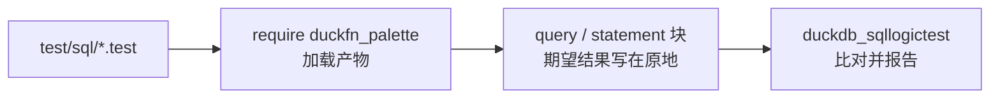

# 测试

测试用 [SQLLogicTest](https://duckdb.org/dev/sqllogictest/intro) 格式写在 `test/sql/` 下，与 DuckDB
自己的测试套件同一种格式。一个文件就是一串 `query` / `statement` 块，期望结果写在原地，所以用例同时也是
函数行为的可运行示例。

| 文件 | 覆盖什么 |
| --- | --- |
| `duckfn_palette.test` | 冒烟：LOAD 之前没有任何 `plt_` 函数、`require` 之后它们全在。它也是「扩展能被加载」的最小证明。 |
| `convert.test` | 每个空间的构造函数、`plt_convert` 在整张空间表上的往返、`plt_clamp` / `plt_is_within_bounds`、alpha 读写、`plt_from_components` 的参数个数报错。 |
| `manipulate.test` | `plt_mix` 的端点与中点、提亮/变暗/加饱和/去饱和的 `_fixed` 与按比例两版、色相偏移与设定、premultiply / unpremultiply，以及「该空间不支持此操作」的报错路径。 |
| `blend.test` | 11 种混合模式、6 种合成算子、自定义方程配全部因子、源/目的顺序、alpha 处理。 |
| `difference.test` | 7 个度量对着 palette 自己断言的值、WCAG 相对亮度与对比度（黑/白 = 21）、`plt_contrast_check` 的每条准则。 |
| `theory.test` | 色相空间上的配色方案函数、按名字取 `plt_harmony`、列表长度、「没有色相」的报错。 |
| `named.test` | 整张表的命名色、大小写与分隔符规范化、未知名字的报错。 |
| `css.test` | csscolorparser：hex / `rgb()` / `hsl()` / `lab()` / `oklch()` / `color()` 解析、序列化格式、非法输入 → `plt_css_is_valid` 为假且结果为 `NULL`。 |
| `cast.test` | 四种通道顺序的打包/解包、8 位量化的往返、打包值的 hex 输出、顺序名的报错。 |
| `encoding.test` | 传输函数 decode/encode 对着 palette 断言的值、101 点往返、原色之和等于白点、RGB↔XYZ 矩阵及其逆。 |
| `adaptation.test` | 16 个白点、三种色适应方法对着 palette 上游矩阵（1e-4 容差）、完整矩阵能拆成 LMS · gain · LMS⁻¹、alpha 保持不变。 |
| `matrix.test` | palette 自己的 `multiply_3x3` / `apply` 断言、求逆检查、`inverse(adaptation)` ≈ 反向适应、奇异矩阵报错、`matrix_arg` 长度报错。 |
| `cam16.test` | palette 断言的 7 个 CAM16 颜色、全属性与部分空间的往返、自定义观察条件改变结果、默认条件下与 `plt_convert` 一致。 |
| `colorous.test` | 每个渐变与分类色板的名字、端点与 `t` 的夹紧、等距采样列表、整份分类色板、未知名字与 `n < 1` 的报错。 |
| `random.test` | 每个随机空间标签都与请求一致、同种子同色、不同种子不同色、序列前缀、200 个种子上的分量取值范围、没有分布的空间。 |

## 怎么跑

一个文件是怎么走到运行器的：



```shell
just test                 # = make configure + make debug + make test
just ci-build             # 只做官方构建，不跑测试
```

`just test` 走 DuckDB 官方的 Makefile 流程，CI 也是这条。两件要知道的事：

- **它不会自动重新构建。** 改完 Rust 先跑 `just ci-build`（或 `make debug`），否则测试跑的是上一次的
  产物。
- **Windows 上 `make` 必须在 Git Bash 里跑**，PowerShell 里跑不起来。

### 更快的迭代

DuckDB 的测试运行器可以直接驱动产物，完全跳过 `make`。它需要一个装了 `duckdb_sqllogictest` 的 Python
环境 —— `make configure` 会在 `configure/venv` 下建一个，你也可以用任何装了这个包的 Python 3 环境：

```bash
# Linux / macOS
./configure/venv/bin/python -m duckdb_sqllogictest \
    --test-dir test/sql \
    --external-extension build/debug/duckfn_palette.duckdb_extension
```

```powershell
# Windows
.\configure\venv\Scripts\python.exe -m duckdb_sqllogictest `
    --test-dir test/sql `
    --external-extension build/debug/duckfn_palette.duckdb_extension
```

`--test-dir` 必给：它同时是 `__TEST_DIR__` 的取值，也就是会落盘写文件的用例拿到的目录。只跑一份就再加
`--file-path test/sql/convert.test`。

## 约定

- **每个文件都从干净的数据库开始**，所以 `duckfn_palette.test` 可以断言加载前函数不存在，其余文件开头写
  `require duckfn_palette`。
- **错误是子串匹配。** `statement error` 下面写有辨识度的那一段就够了，不必抄 DuckDB 整条错误消息 ——
  抄全了反而会把用例绑死在一个随时可能改的文案上。
- **期望的数字只信上游，不要重新推导。** palette 自己的 `assert` 与 doctest 值就是真相；palette 用容差
  比较的地方，测试也用容差 —— 但断言的是违规条数，不是渲染出来的浮点数：

  ```sql
  query I
  SELECT count(*) FROM (SELECT unnest(plt_adaptation_matrix('d65','d50','bradford')) AS a,
                              unnest([1.0478112, 0.0228866, …]) AS e)
  WHERE abs(a - e) >= 0.0001;
  ----
  0
  ```

- **留意值怎么打印。** `DOUBLE` 打印成 `7.0`，`I` 列里的 `BOOLEAN` 打印成 `1` / `0`。用例关心的是值而不是
  类型时，转一下（`…::VARCHAR`）或改用 `count(*)` 断言，这样类型变了期望值也不用改。
- **按关注点拆文件**：一个 palette 模块一份，与 `src/extension/functions/` 一一对应。

## 新增函数至少覆盖什么

正常值、`NULL`、边界值、错误路径。对这个扩展来说，边界值就是一个不存在的空间名、模式名或度量名 ——
错误消息以函数名开头。另外三条很值：

- 往返（`plt_convert` 转出去再转回来、`plt_pack` 再 `plt_unpack`）—— 分量顺序写反了，单个值看不出来，
  往返能；
- alpha 通道在每个操作后都还在 —— 每个函数族断言一次，不必每个函数都断言；
- 行数超过 `STANDARD_VECTOR_SIZE`（2048）的用例 —— 标量的逐 chunk 路径靠它才跑到，
  `generate_series` 是最短的路。

提交前：`just lint`（`cargo clippy --all-targets -- -D warnings`）。
